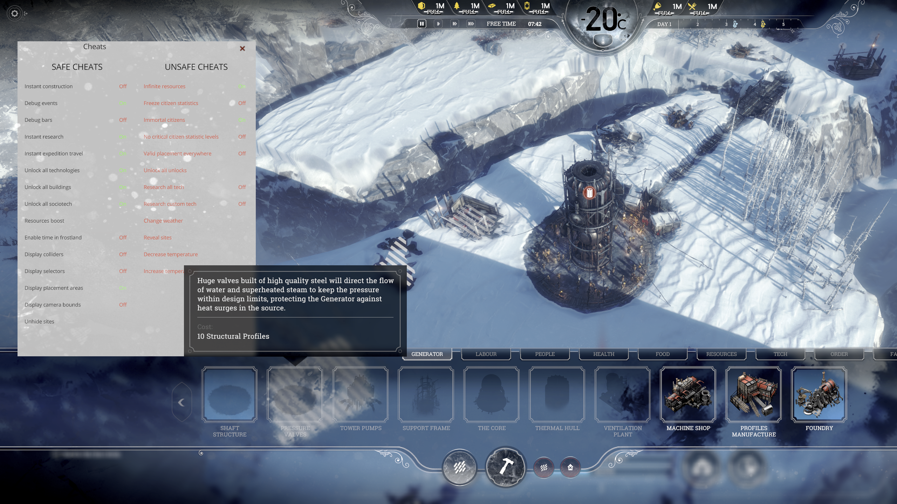

# Frostpunk Dev Menu (F10)

**Press F10 in a running city to open Frostpunk's own built-in developer panel.**

> **We did not make this panel.** The developer panel and every cheat in it were built by
> 11 bit studios and ship inside every copy of Frostpunk 1. The game simply has no button or key
> that opens it. This mod only adds that key: F10 calls the game's own
> `ShowDebugButtonsPanel()` function. No cheat, button or game feature here is ours.

- Frostpunk 1 on **Windows**, **macOS**, and **Linux / Steam Deck** (the Windows version in Proton)
- Fully reversible: uninstall puts the game files back exactly as they were (byte for byte)
- Not affiliated with or endorsed by 11 bit studios



See [docs/dev-panel.md](docs/dev-panel.md) for everything the panel can do.

## Install

Download the zip from the [Releases](../../releases) page (or from Nexus Mods), unzip it anywhere,
**quit Frostpunk**, then:

| System | Double-click | Notes |
|---|---|---|
| Windows | `Install Dev Menu (Windows).bat` | If Windows shows "Windows protected your PC": *More info → Run anyway*. |
| macOS | `Install Dev Menu (Mac).command` | First time: right-click → *Open*. On macOS 15+: try to open it once, then *System Settings → Privacy & Security → Open Anyway*. |
| Linux / Steam Deck | `install-dev-menu-linux.sh` | Open a terminal in the folder and run `bash install-dev-menu-linux.sh`. Steam Deck: use Desktop Mode. |

The installer finds Frostpunk in your Steam library by itself (it asks for the folder if it
can't), shows whether the Dev Menu is installed, and offers **Install** or **Uninstall**.

Then start the game, **load or start a city, and press F10**. Press F10 again to hide the panel.
In the main menu F10 does nothing visible: the panel only exists inside a city.

**You install it once.** The change is saved in the game files, so F10 keeps working every time
you start Frostpunk from Steam as usual; there is nothing to run before playing. Run the
installer again only after a Frostpunk update or a Steam "Verify integrity of game files", which
put the original files back (if F10 suddenly stops working, that is why).

### What the three wrapper files are

**The `.bat`, `.command` and `.sh` files do not change the game.** All the work is done by
one Python script, `dev_menu.py`. The wrappers exist only so that a non-technical player can
start that script with a double-click: each one looks for Python on your computer, runs
`dev_menu.py` with it, and keeps the window open so you can read the result. If Python is not
installed, the wrapper asks whether to install it and then starts the **official** installer,
which you approve yourself:

- Windows: `winget install Python.Python.3.13` (Windows' own package tool), or, without winget,
  the python.org setup, downloaded and checked to be signed by the Python Software Foundation.
  Windows shows its usual permission prompt.
- macOS: downloads the python.org installer package, checks its Python Software Foundation
  signature, and opens it. You click through it; macOS asks for your password.
- Linux: runs your package manager with `sudo` (apt, dnf, pacman or zypper), which asks for your
  password.

Once Python is installed the wrapper carries on by itself. You can open any wrapper in a text
editor to check all this: each is plain text, under 80 lines.

### Without the wrappers (run the Python script yourself)

You need Python 3.6 or newer (https://www.python.org/downloads/). Open a terminal / command
prompt in the unzipped folder and run:

```
python3 dev_menu.py              # interactive menu (Windows: py -3 dev_menu.py)
python3 dev_menu.py install      # install
python3 dev_menu.py uninstall    # uninstall
python3 dev_menu.py status       # is it installed?
python3 dev_menu.py install --game-dir "D:\Games\Frostpunk"    # game not found automatically
```

`--game-dir` takes the Frostpunk game folder (the one with `common.idx`, or on macOS the folder
with `Frostpunk.app`). GOG and Epic copies are not found automatically: use `--game-dir`.

## Uninstall

Quit Frostpunk and run the installer again (or `python3 dev_menu.py uninstall`). Alternatively,
*Steam → Frostpunk → Properties → Installed Files → Verify integrity of game files* also
removes it.

**A Frostpunk update or a Steam file verification removes the Dev Menu.** Just install it again.

## Be careful with the panel

This is the developers' own test panel. Some buttons make permanent changes to the city you are
playing, and some are listed by the game itself as "unsafe cheats".

- **Use a copy of your save**, or a new throwaway city.
- Achievements: we have not tested whether using cheats affects Steam achievements. Assume it might.
- Opening the panel pauses the game.

## How it works

Frostpunk keeps its data in packed archives (`common.idx` + `common.dat`). At startup the game
runs a series of Lua scripts; the last one, `GameMain.lua`, ships empty. The installer appends
about 15 lines of Lua to it that listen for F10 and call the game's own
`ShowDebugButtonsPanel()` / `HideDebugButtonsPanel()`:

```lua
function LuaGameDelegate:OnInputEvent(...)
  local r = prev and prev(self, ...)
  local ev, key = ...
  if ev == INPUTEVENT_KEYBOARD_KEYDOWN and (key == 121 or key == DIK_F10) then
    shown = not shown
    if shown then ShowDebugButtonsPanel() else HideDebugButtonsPanel() end
  end
  return r
end
```

The changed script is **appended** to the end of `common.dat` and its single entry in
`common.idx` is pointed at it; no game data is overwritten. A backup of the original entry is
kept next to the archive in `common.idx.devmenu.json`, and uninstall restores the entry and
trims `common.dat` back to its original size.

Archive format, for other modders: `common.idx` = 11-byte header (entry count as u32 at offset
3), then 29-byte entries (`<IQQQB`: file id, stored size, real size, offset in `.dat`, gzip
flag). The gzip streams in `.dat` carry no CRC/size trailer. `GameMain.lua` has id `0x962DD588`
on every platform.

Not possible: dropping a loose `GameMain.lua` into a folder. We tested it; the game only
loads scripts from its archives. Also, the `-devconsole` launch option does not open this panel
on its own.

## Credits and licence

- The developer panel, its cheats and Frostpunk itself: © 11 bit studios. This project contains
  no game files.
- This installer: MIT licence, see [LICENSE](LICENSE).
