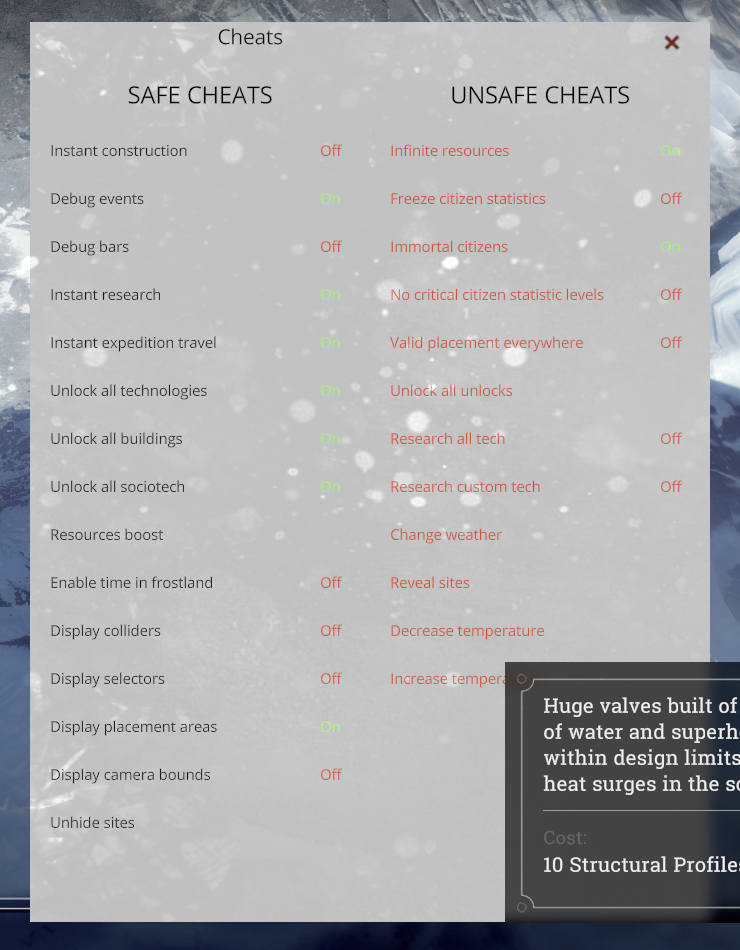

# The developer panel: what's in it

**This panel was made by 11 bit studios and is part of the game.** The Dev Menu mod only lets
you open it with F10; it adds no buttons and changes no cheat.

The panel is titled **Cheats** and has two columns, exactly as the game sorts them: **Safe
cheats** and **Unsafe cheats** (shown in red). *Toggle* buttons show **On** (green) or **Off**
(red) and stay as set; *action* buttons have no On/Off and do something once per click.

The names are the game's own labels. The descriptions explain what each label says the button
does; corrections are welcome (open an issue). **Try unsafe cheats on a copy of your save.**

## Safe cheats

| Button | Type | What it does |
|---|---|---|
| Instant construction | toggle | Buildings, roads and upgrades finish the moment you place them. |
| Debug events | toggle | Developer tools for the game's event / dilemma system. |
| Debug bars | toggle | Shows developer status bars on screen. |
| Instant research | toggle | Research in workshops finishes immediately. |
| Instant expedition travel | toggle | Scouts and expeditions arrive at their destination immediately. |
| Unlock all technologies | toggle | Makes every technology available to research. |
| Unlock all buildings | toggle | Makes every building available in the build menu. |
| Unlock all sociotech | toggle | Makes every law (Book of Laws) available to sign. |
| Resources boost | action | Adds a large one-off amount of resources to your stockpile. |
| Enable time in frostland | toggle | Lets time run while the Frostland map is open. |
| Display colliders | toggle | Shows the game's internal collision shapes. |
| Display selectors | toggle | Shows the game's internal selection markers. |
| Display placement areas | toggle | Shows where buildings can be placed. |
| Display camera bounds | toggle | Shows how far the camera may move. |
| Unhide sites | action | Makes hidden Frostland map sites visible. |

## Unsafe cheats

| Button | Type | What it does |
|---|---|---|
| Infinite resources | toggle | Resources are not used up when you build, research or consume. |
| Freeze citizen statistics | toggle | Hope, discontent, health and similar values stop changing. |
| Immortal citizens | toggle | Citizens do not die. |
| No critical citizen statistic levels | toggle | Prevents stats from reaching their critical (game-ending) levels. |
| Valid placement everywhere | toggle | Lets you place buildings where the game would normally refuse. |
| Unlock all unlocks | action | Unlocks every other locked game element. |
| Research all tech | toggle | Completes every technology in the tech tree. |
| Research custom tech | toggle | Completes a preset subset of technologies. |
| Change weather | action | Switches to another weather state. |
| Reveal sites | action | Reveals the locations on the Frostland map. |
| Decrease temperature | action | Lowers the outside temperature. |
| Increase temperature | action | Raises the outside temperature. |

The game's code also contains *Freeze alignments* and *Reset sociotech cooldown*; they did not
appear in the panel in the scenario we tested (the main story, day 1), so they may show only in
some scenarios.
